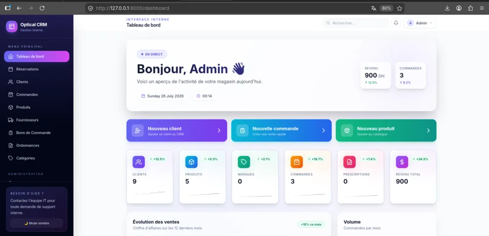
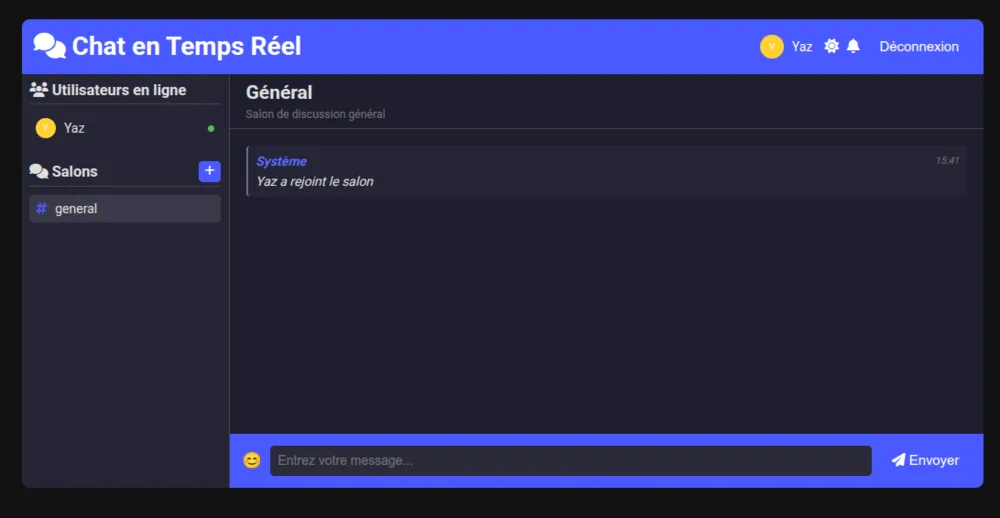
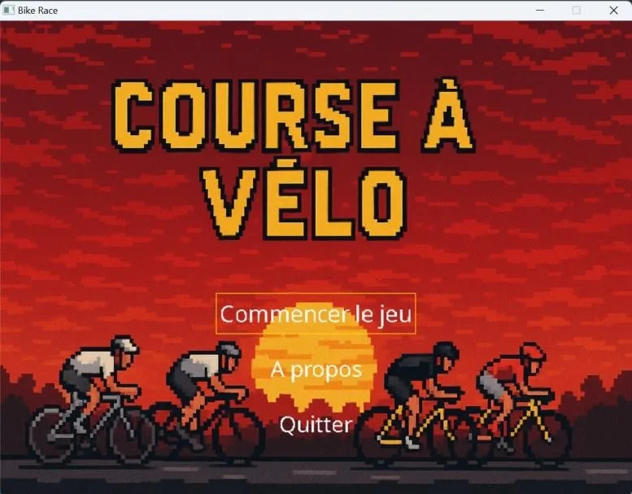
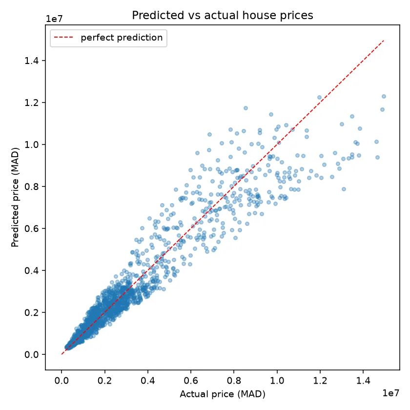
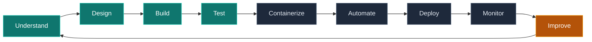
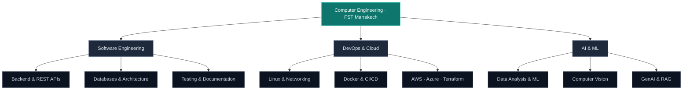

<picture>
  <source media="(prefers-color-scheme: dark)" srcset="assets/hero-dark.svg">
  <source media="(prefers-color-scheme: light)" srcset="assets/hero-light.svg">
  
</picture>

 

## At a glance

<table>
<tr>
<td width="62%" valign="top">
<h3>Who I am</h3>

I am a <strong>Computer Engineering student in the IRISI program</strong> at <strong>FST Marrakech — Cadi Ayyad University</strong>. I like building a system end to end: the application, the database, the container, the pipeline, and the monitoring around it.

My current direction is <strong>software engineering</strong>, with growing strengths in <strong>DevOps/Cloud</strong> and <strong>AI/ML</strong>. I learn by shipping real projects, documenting decisions, and understanding why a system works — not only that it works.

</td>
<td width="38%" valign="top">
<h3>Right now</h3>

<strong>Building</strong> SmartPark Maroc — licence-plate detection and OCR

<strong>Learning</strong> Docker · CI/CD · cloud · computer vision

<strong>Open to</strong> Software · DevOps · AI/ML internships

<strong>Based in</strong> Marrakech, Morocco

</td>
</tr>
</table>

## Currently building

### SmartPark Maroc
**Moroccan licence-plate detection + OCR.**

An end-to-end computer-vision project: dataset validation, YOLO training, OCR, and a Streamlit interface. The dataset is prepared with **1,596 labelled images**; training and evaluation are the next milestone. No metrics are claimed until the model is actually trained.

| Stage | Status |
|---|---|
| Dataset | Ready — 1,596 labelled pairs, 1,277 / 319 train-val split |
| Detector | Training next on Colab T4 |
| OCR | In progress |
| Application | Streamlit prototype |

[Explore SmartPark Maroc →](https://github.com/mohamedait-abbou/SmartPark-computer-vision-project)

## Selected work

<table>
<tr>
<td width="50%" valign="top">
<h3><a href="https://github.com/mohamedait-abbou/SmartPark-computer-vision-project">SmartPark Maroc</a></h3>

End-to-end computer vision for Moroccan licence plates: detection, OCR, and a Streamlit interface.

<code>Python</code> <code>PyTorch</code> <code>YOLO11</code> <code>OpenCV</code> <code>Streamlit</code>

<strong>Concrete detail:</strong> 1,596 labelled pairs prepared; detector training is next.

</td>
<td width="50%" valign="top">
<h3><a href="https://github.com/mohamedait-abbou/DarPrice-Moroccan-House-Price-Prediction">DarPrice</a></h3>

Machine-learning pipeline for Moroccan real-estate price prediction.

<code>Python</code> <code>Pandas</code> <code>scikit-learn</code> <code>FastAPI</code>

<strong>Models:</strong> Ridge · Random Forest · HistGradientBoosting, evaluated with MAE, RMSE, and R².

</td>
</tr>
<tr>
<td width="50%" valign="top">
<h3><a href="https://github.com/mohamedait-abbou/optical-management-system">Optical CRM</a></h3>

Full-stack management platform for optical stores, built during my SEOCOM internship.

<code>Laravel</code> <code>PHP</code> <code>MySQL</code> <code>Docker</code> <code>GitHub Actions</code>

<strong>Scope:</strong> inventory · orders · PDF invoices · appointments · RBAC · KPI dashboard.

</td>
<td width="50%" valign="top">
<h3><a href="https://github.com/mohamedait-abbou/dns-monitor">DNS Traffic Monitor</a></h3>

Python DNS packet analyzer for security monitoring, suspicious-domain detection, and rate-limiting alerts.

<code>Python</code> <code>Scapy</code> <code>Networking</code> <code>Security</code>

<strong>Features:</strong> live capture · pcap analysis · summary reports.

</td>
</tr>
</table>

## Project gallery

<table>
<tr>
<td width="50%" valign="top">

<strong>Optical CRM</strong> — inventory, orders, invoices, and KPIs.

</td>
<td width="50%" valign="top">

<strong>ReelTimeChat</strong> — real-time chat with rooms and notifications.

</td>
</tr>
<tr>
<td width="50%" valign="top">

<strong>Bicycle Racing Game</strong> — C++ and SDL2 game with collisions and scoring.

</td>
<td width="50%" valign="top">

<strong>DarPrice</strong> — model evaluation: predicted versus actual prices.

</td>
</tr>
</table>

<strong>All 8 public projects</strong> — click to expand

 

| Project | What it does | Stack |
|---|---|---|
| [SmartPark Maroc](https://github.com/mohamedait-abbou/SmartPark-computer-vision-project) | Moroccan licence-plate detection and OCR | Python · PyTorch · YOLO11 · OpenCV |
| [DarPrice](https://github.com/mohamedait-abbou/DarPrice-Moroccan-House-Price-Prediction) | Moroccan house-price prediction | Python · scikit-learn · FastAPI |
| [Optical CRM](https://github.com/mohamedait-abbou/optical-management-system) | Optical store management platform | Laravel · PHP · MySQL · Docker |
| [DNS Traffic Monitor](https://github.com/mohamedait-abbou/dns-monitor) | DNS security monitoring and threat detection | Python · Scapy |
| [ReelTimeChat](https://github.com/mohamedait-abbou/Power-Rangers-ReelTimeChat) | Real-time chat with rooms, typing indicators, and notifications | Node.js · Express · Socket.io · MySQL |
| [Bicycle Racing Game](https://github.com/mohamedait-abbou/mini-projet-jeu-velo) | OOP bicycle game with SDL2 graphics and collisions | C++ · SDL2 |
| [Weather App](https://github.com/mohamedait-abbou/weather-app) | City weather search using live API data | HTML · CSS · JavaScript |
| [TP1 JavaScript](https://github.com/mohamedait-abbou/tp1_js) | JavaScript fundamentals exercises | JavaScript |

**Academic team work:** UniReserve — university resource reservation system covering requirements, database design, V-Model process, testing, and technical documentation.

## Stack

**Languages**

**Backend & web**

**Data & databases**

**DevOps & cloud**

**AI & ML**

**Also working with:** REST APIs · authentication · RBAC · SQL · data modeling · TCP/IP · DNS · HTTP/HTTPS · VLANs · OSPF · Wireshark · Nmap · FastAPI · RAG.

## Experience & education

<table>
<tr>
<td width="60%" valign="top">
<h3>SEOCOM — Development Intern</h3>

<strong>Marrakech, Morocco · 2026</strong>

Built <strong>Optical CRM</strong>, a full-stack management platform for optical stores. Worked across the stack: Laravel/PHP backend, Blade/Tailwind frontend, MySQL database, Docker environment, and GitHub Actions CI/CD. Implemented authentication and role-based access control, inventory and orders, partial payments, PDF invoices, appointments, notifications, and a KPI dashboard.

<a href="https://github.com/mohamedait-abbou/optical-management-system">View Optical CRM →</a>

</td>
<td width="40%" valign="top">
<h3>FST Marrakech — Cadi Ayyad University</h3>

<strong>Computer Engineering · IRISI program</strong>

Coursework and projects across software engineering, databases, networking, operating systems, and AI/ML.

</td>
</tr>
</table>

## GitHub snapshot

 

 

<strong>More GitHub charts</strong> — languages and commit habits

 

## How I build

## Learning roadmap

## Connect

  

**Open to software engineering, DevOps, and AI/ML internships.**  
Based in Marrakech, Morocco · open to remote and hybrid.

<picture>
  <source media="(prefers-color-scheme: dark)" srcset="assets/footer-dark.svg">
  <source media="(prefers-color-scheme: light)" srcset="assets/footer-light.svg">
  
</picture>
